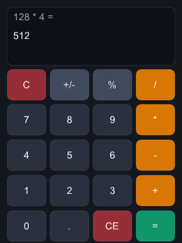
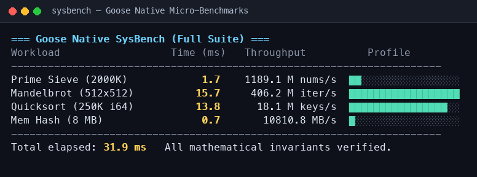
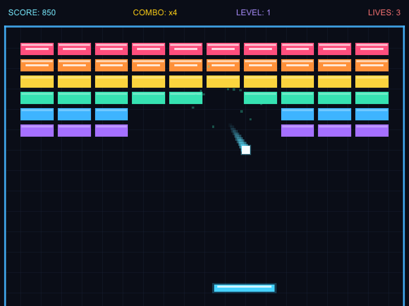

# List of Goose apps made by Heaven

<p align="center">
  
  
  
  
</p>

A curated, tested, and optimized collection of **7 standalone applications and games** written in the [**Goose**](https://github.com/aardappel/goose) systems programming language — spanning **Desktop GUI**, **CLI Utilities**, **2D Terminal UI (Console)**, **2D GPU Arcade**, and **3D GPU Graphics**.

> Separate directories for clean source code ([`src/`](src/)) and compiled executables ([`builds/`](builds/)), with reproducible test suites, headless screenshot generation, and prebuilt binaries attached on [GitHub Releases](https://github.com/haseeb-heaven/heaven_goose/releases).

---

## Apps Overview

| App | Category | Libraries Used | Source Code | Binary |
|---|---|---|---|---|
| [**Calculator**](#1-calculator-gui) | Desktop GUI | `gfx`, `ui` (`goose_gfx`) | [`src/gui/calculator/calculator.goose`](src/gui/calculator/calculator.goose) | `builds/calculator` |
| [**Pomodoro**](#2-pomodoro-gui) | Desktop GUI + Audio | `gfx`, `ui`, `audio` (`goose_gfx`) | [`src/gui/pomodoro/pomodoro.goose`](src/gui/pomodoro/pomodoro.goose) | `builds/pomodoro` |
| [**DevBox**](#3-devbox-cli) | CLI Toolkit | `std`, `os`, `base64`, [`goose-uuid`](https://github.com/Macho0x/goose-uuid) | [`src/cli/devbox/devbox.goose`](src/cli/devbox/devbox.goose) | `builds/devbox` |
| [**SysBench**](#4-sysbench-cli) | CLI Benchmark | `std`, `os`, `math` | [`src/cli/sysbench/sysbench.goose`](src/cli/sysbench/sysbench.goose) | `builds/sysbench` |
| [**Term Snake**](#5-term-snake-2d-console-game) | 2D Console (TUI) | `std`, `os`, `math`, [`goose-tui`](https://github.com/ZHENGSY/goose-tui) | [`src/console/term_snake/term_snake.goose`](src/console/term_snake/term_snake.goose) | `builds/term_snake` |
| [**Neon Breakout**](#6-neon-breakout-2d-gpu-game) | 2D GPU Game | `gfx`, `ui`, `audio`, `vec`, `math` | [`src/games2d/neon_breakout/neon_breakout.goose`](src/games2d/neon_breakout/neon_breakout.goose) | `builds/neon_breakout` |
| [**Voxel Runner**](#7-voxel-runner-3d-gpu-game) | 3D GPU Game | `gfx`, `ui`, `audio`, `vec`, `math` | [`src/games3d/voxel_runner/voxel_runner.goose`](src/games3d/voxel_runner/voxel_runner.goose) | `builds/voxel_runner` |

---

## Showcase & Screenshots

### 1. Calculator (GUI)

A responsive, Retina/HiDPI-aware desktop calculator rendered with Nuklear + SDL3 GPU (`goose_gfx`) and an embedded TrueType font (`Roboto-Regular.ttf`).

<p align="center">
  
</p>

- **Features**: Full-window responsive grid, automatic HiDPI scaling, color-coded buttons (slate digits, amber operators, crimson `C`/`CE`, emerald `=`), chained arithmetic, `%`, `+/-`, division-by-zero error recovery, and full mouse + keyboard input (`0`-`9`, `.`, `+ - * /`, `Enter`/`=`, `Backspace`, `C`, `Esc`).
- **Run**:
  ```sh
  ./builds/calculator
  ```

---

### 2. Pomodoro (GUI)

A focus timer and stopwatch with a smooth custom canvas progress ring, mode switcher, session tracker, and synthesized audio chime.

<p align="center">
  
</p>

- **Features**: Four modes (**Focus 25:00**, **Short Break 05:00**, **Long Break 15:00**, **Stopwatch**), anti-aliased progress arc, automatic break transitions every 4 focus sessions, `+1 Min` adjustment, procedural 48 kHz sine-chord chime via `audio`, and keyboard shortcuts (`Space` start/pause, `R` reset, `Esc` quit).
- **Run**:
  ```sh
  ./builds/pomodoro
  ```

---

### 3. DevBox (CLI)

A fast, zero-dependency developer Swiss-army CLI combining Goose's stdlib (`base64`, `os`, `hash`) with [`Macho0x/goose-uuid`](https://github.com/Macho0x/goose-uuid) from [`goose-index`](https://github.com/safdafang/goose-index).

<p align="center">
  
</p>

- **Commands**:
  ```sh
  ./builds/devbox uuid --v4 -n 3
  ./builds/devbox uuid --v7
  ./builds/devbox pass -l 24
  ./builds/devbox b64 encode "Heaven Goose"
  ./builds/devbox b64 decode "SGVhdmVuIEdvb3Nl"
  ./builds/devbox hash "Heaven Goose"
  ./builds/devbox stats src/cli/devbox/devbox.goose
  ./builds/devbox demo
  ```

---

### 4. SysBench (CLI)

A native CPU & memory micro-benchmark suite demonstrating Goose's `-O2` compiled performance with self-verifying mathematical invariants and proportional ANSI bar charts.

<p align="center">
  
</p>

- **Workloads**:
  1. **Prime Sieve (2M)**: Sieve of Eratosthenes asserting exact prime count (`148,933`).
  2. **Mandelbrot (512×512)**: Double-precision complex escape-time kernel.
  3. **Quicksort (250K `i64`)**: Deterministic PRNG array sort with strict order verification.
  4. **Memory Hash (8 MB)**: Sequential 4 KB block hashing throughput.
- **Run**:
  ```sh
  ./builds/sysbench          # Full suite
  ./builds/sysbench --quick  # Quick suite
  ./builds/sysbench --json   # Machine-readable JSON output
  ```

---

### 5. Term Snake (2D Console Game)

A 24-bit TrueColor 2D terminal arcade Snake game built on [`ZHENGSY/goose-tui`](https://github.com/ZHENGSY/goose-tui), using cell-level ANSI diffing so idle frames emit zero bytes.

<p align="center">
  
</p>

- **Features**: Glowing gradient snake body, red apples (`+10`), timed golden bonus gems (`+50`), progressive speed levels, HUD gauge to next level, pause/restart overlay, and headless terminal test harness.
- **Controls**: `Arrow Keys` or `WASD` to steer · `P` pause · `R` restart · `Q` / `Esc` quit.
- **Run**:
  ```sh
  ./builds/term_snake
  ```

---

### 6. Neon Breakout (2D GPU Game)

A custom-shader 2D GPU arcade game batching all bricks, walls, paddle, motion trail, and impact sparks into a single vertex buffer draw call per frame, paired with a Retina HUD and procedural PCM sound effects.

<p align="center">
  
</p>

- **Features**: 6×10 neon brick field (2-hit armored top rows + 1-hit lower rows), angle-based paddle physics, combo score multiplier, 10-frame ball trail, gravity-affected spark bursts, and pitch-scaled combo audio blips.
- **Controls**: `Space` launch/pause · `A`/`D` or `Left`/`Right` move paddle · `R` restart · `Esc` quit.
- **Run**:
  ```sh
  ./builds/neon_breakout
  ```

---

### 7. Voxel Runner (3D GPU Game)

A 3D endless cyber-highway runner written with custom GLSL vertex/fragment shaders (compiled to Metal / SPIR-V / HLSL), depth testing, directional + hemisphere lighting, and exponential horizon fog.

<p align="center">
  
</p>

- **Features**: Single-draw batched 3D world mesh (glowing cyber highway, rushing lane markers, synthwave skyline towers, tall monoliths, jump barriers, spinning golden pickups, and hovering cyber-craft), smooth lane interpolation, jump gravity, speed ramp, and procedural SFX.
- **Controls**: `A`/`D` or `Left`/`Right` switch lane · `Space`/`W`/`Up` jump · `R` restart · `Esc` quit.
- **Run**:
  ```sh
  ./builds/voxel_runner
  ```

---

## Downloads (Prebuilt Binaries)

Prebuilt native executables and checksums are published on the [**Releases Page**](https://github.com/haseeb-heaven/heaven_goose/releases):

- **Latest Release**: [`github.com/haseeb-heaven/heaven_goose/releases/latest`](https://github.com/haseeb-heaven/heaven_goose/releases/latest)
- **v1.0.0 Release**: [`github.com/haseeb-heaven/heaven_goose/releases/tag/v1.0.0`](https://github.com/haseeb-heaven/heaven_goose/releases/tag/v1.0.0)

Available assets in `v1.0.0`:
- **`heaven_goose-v1.0.0-macos-arm64.tar.gz`** — Archive with all 7 compiled apps + `LICENSE` + `README.md`
- Individual executables: `calculator-macos-arm64`, `pomodoro-macos-arm64`, `devbox-macos-arm64`, `sysbench-macos-arm64`, `term_snake-macos-arm64`, `neon_breakout-macos-arm64`, `voxel_runner-macos-arm64`
- **`SHA256SUMS.txt`** — SHA-256 verification checksums

### Running Downloaded Binaries on macOS

```sh
tar -xzf heaven_goose-v1.0.0-macos-arm64.tar.gz
cd heaven_goose-v1.0.0-macos-arm64
chmod +x *
# Optional if downloaded via browser and Gatekeeper flags quarantine:
xattr -d com.apple.quarantine * 2>/dev/null || true

./calculator
```

To verify checksums before running:

```sh
shasum -a 256 -c SHA256SUMS.txt
```

---

## How to Build & Run for Your System

### Prerequisites

1. Install the [**Goose compiler**](https://github.com/aardappel/goose/releases) (`v2026.4` or newer) and ensure `goose` is on your `PATH`.
   - You can also build Goose from source via CMake + C++20 compiler (`goose toolchain` verifies your setup).
2. Ensure a C compiler (`clang`, `gcc`, or `msvc`) is available (`goose build` uses it to emit native binaries).
3. Clone this repository:
   ```sh
   git clone https://github.com/haseeb-heaven/heaven_goose.git
   cd heaven_goose
   ```

### macOS (Apple Silicon / Intel) & Linux (`x86_64` / `arm64`)

Build all 7 apps into `builds/`:
```sh
./scripts/build_all.sh
```

Run all typechecks, unit tests (`--test`), CLI checks, and headless GPU smoke tests:
```sh
./scripts/test_all.sh
```

Build and run a single app manually:
```sh
goose build -O2 src/gui/calculator/calculator.goose -o builds/calculator
./builds/calculator
```

*(Note: `term_snake` targets POSIX terminals — macOS & Linux — via `goose-tui`'s `termios` layer. All other 6 apps build across macOS, Linux, and Windows.)*

### Windows (`x86_64`, PowerShell / Command Prompt)

With Goose (`goose.exe`) and MSVC / clang-cl installed (`goose toolchain` to verify):

```powershell
mkdir builds -Force
goose build -O2 src\gui\calculator\calculator.goose -o builds\calculator.exe
goose build -O2 src\gui\pomodoro\pomodoro.goose -o builds\pomodoro.exe
goose build -O2 src\cli\devbox\devbox.goose -o builds\devbox.exe
goose build -O2 src\cli\sysbench\sysbench.goose -o builds\sysbench.exe
goose build -O2 src\games2d\neon_breakout\neon_breakout.goose -o builds\neon_breakout.exe
goose build -O2 src\games3d\voxel_runner\voxel_runner.goose -o builds\voxel_runner.exe

.\builds\calculator.exe --test
.\builds\calculator.exe
```

### Regenerating Screenshots

Requires Python 3 + Pillow (`pip install pillow`) for rendering ANSI terminal captures:
```sh
python3 ./scripts/capture_screenshots.py
```

---

## Project Structure

```text
heaven_goose/
├── LICENSE
├── README.md
├── .gitignore
├── assets/
│   └── Roboto-Regular.ttf          # Embedded TrueType UI font
├── src/
│   ├── gui/
│   │   ├── calculator/calculator.goose
│   │   └── pomodoro/pomodoro.goose
│   ├── cli/
│   │   ├── devbox/devbox.goose
│   │   └── sysbench/sysbench.goose
│   ├── console/
│   │   └── term_snake/term_snake.goose
│   ├── games2d/
│   │   └── neon_breakout/neon_breakout.goose
│   └── games3d/
│       └── voxel_runner/voxel_runner.goose
├── builds/                         # Output folder for compiled binaries (git-ignored)
│   └── README.md
├── screenshots/                    # Verified app screenshots rendered in README
│   ├── calculator.png
│   ├── pomodoro.png
│   ├── devbox.png
│   ├── sysbench.png
│   ├── term_snake.png
│   ├── neon_breakout.png
│   └── voxel_runner.png
└── scripts/
    ├── build_all.sh                # Compile all 7 apps with -O2
    ├── test_all.sh                 # Typecheck + run all test suites
    ├── capture_screenshots.py      # Capture GUI/2D/3D + TrueColor terminal PNGs
    └── package_release.sh          # Package release binaries, tar.gz & SHA256SUMS
```

---

## Libraries & Ecosystem

Built using packages from the Goose ecosystem and [`safdafang/goose-index`](https://github.com/safdafang/goose-index):
- [`aardappel/goose`](https://github.com/aardappel/goose) — Compiler, runtime, and standard library (`std`, `os`, `math`, `vec`, `base64`)
- [`aardappel/goose_gfx`](https://github.com/aardappel/goose_gfx) — SDL3 GPU (`gfx`), Nuklear (`ui`), and PCM mixer (`audio`)
- [`ZHENGSY/goose-tui`](https://github.com/ZHENGSY/goose-tui) — Immediate-mode diffed terminal UI framework
- [`Macho0x/goose-uuid`](https://github.com/Macho0x/goose-uuid) — RFC 9562 UUID generator

---

## License

Licensed under the [MIT License](LICENSE).  
`assets/Roboto-Regular.ttf` is distributed under the Apache License, Version 2.0.
