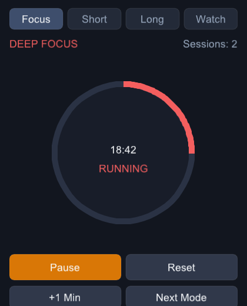
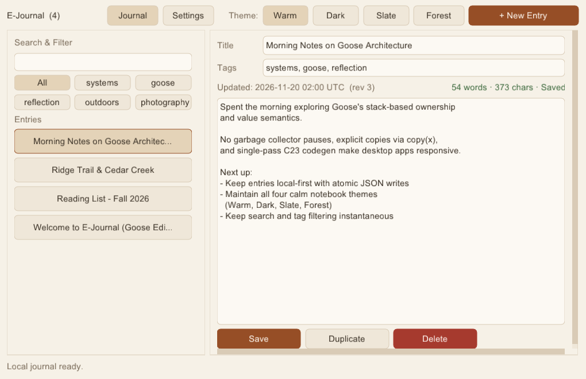
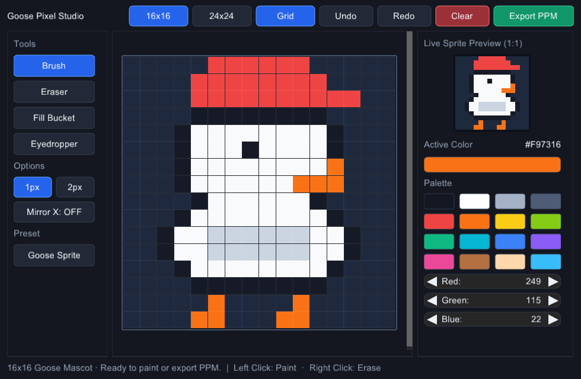
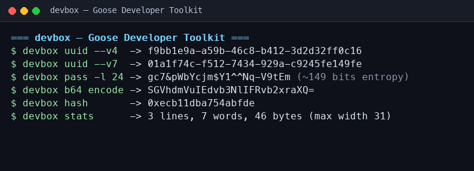
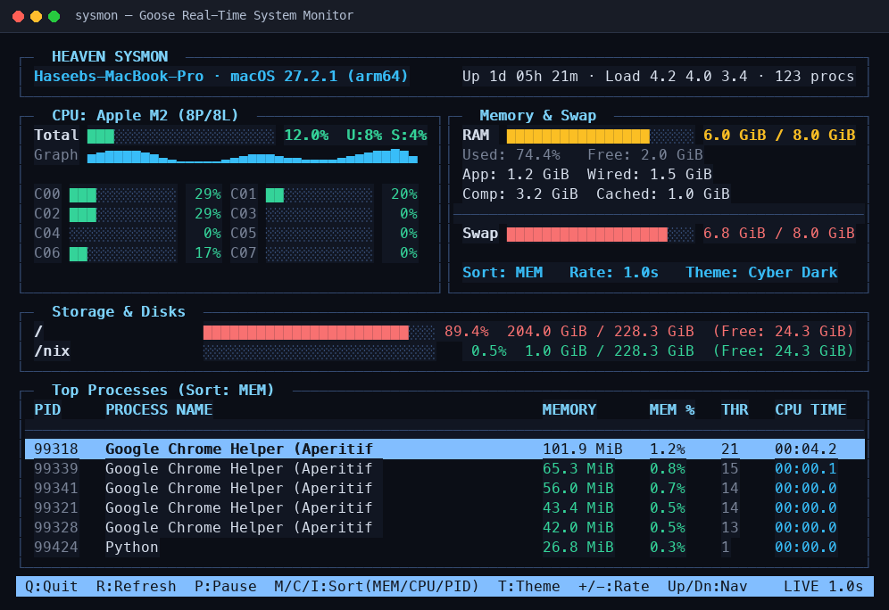
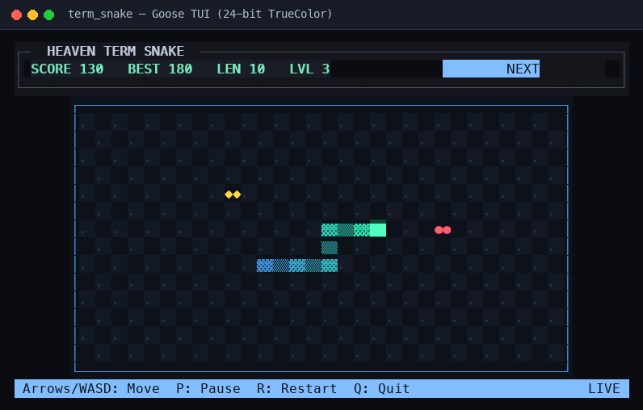
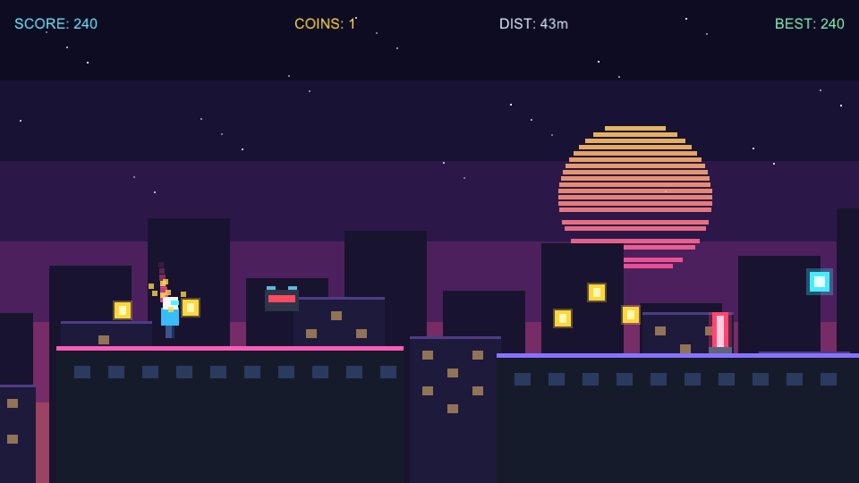
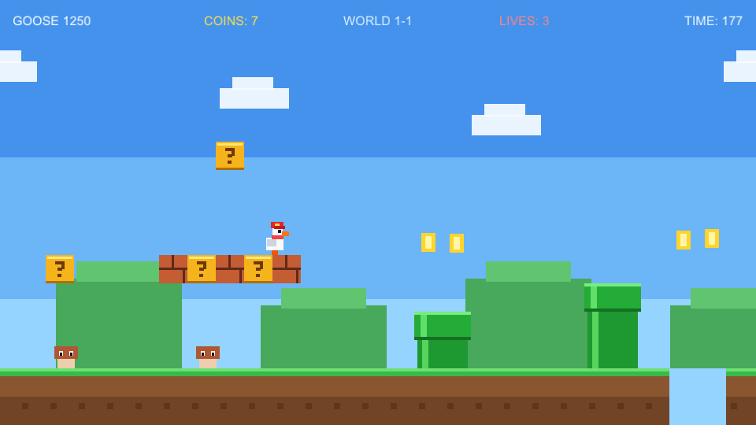
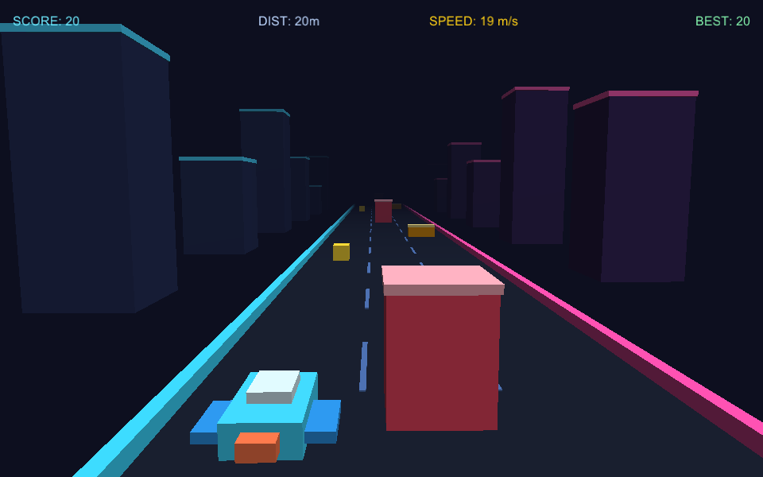

# List of Goose apps made by Heaven

<p align="center">
  
  
  
  
</p>

A curated, tested, and optimized collection of **12 standalone applications and games** written in the [**Goose**](https://github.com/aardappel/goose) systems programming language — spanning **Desktop GUI Apps**, **CLI Utilities**, **2D Terminal UI (System Monitor & Console Game)**, **2D GPU Arcade / Runner / Platformer**, and **3D GPU Graphics**.

> Separate directories for clean source code ([`src/`](src/)) and compiled executables ([`builds/`](builds/)), with reproducible test suites, headless screenshot generation, and prebuilt binaries attached on [GitHub Releases](https://github.com/haseeb-heaven/awesome_goose/releases).

---

## Apps Overview

| App | Category | Libraries Used | Source Code | Binary |
|---|---|---|---|---|
| [**Calculator**](#1-calculator-gui) | Desktop GUI | `gfx`, `ui` (`goose_gfx`) | [`src/gui/calculator/calculator.goose`](src/gui/calculator/calculator.goose) | `builds/calculator` |
| [**Pomodoro**](#2-pomodoro-gui) | Desktop GUI + Audio | `gfx`, `ui`, `audio` (`goose_gfx`) | [`src/gui/pomodoro/pomodoro.goose`](src/gui/pomodoro/pomodoro.goose) | `builds/pomodoro` |
| [**E-Journal**](#3-e-journal-gui) | Desktop GUI App | `gfx`, `ui`, `json`, `os`, [`goose-date`](https://github.com/clintecker/goose-date) | [`src/gui/e_journal/e_journal.goose`](src/gui/e_journal/e_journal.goose) | `builds/e_journal` |
| [**Pixel Studio**](#4-pixel-studio-gui) | Desktop GUI Editor | `gfx`, `ui`, `os`, `std` | [`src/gui/pixel_studio/pixel_studio.goose`](src/gui/pixel_studio/pixel_studio.goose) | `builds/pixel_studio` |
| [**DevBox**](#5-devbox-cli) | CLI Toolkit | `std`, `os`, `base64`, [`goose-uuid`](https://github.com/Macho0x/goose-uuid) | [`src/cli/devbox/devbox.goose`](src/cli/devbox/devbox.goose) | `builds/devbox` |
| [**SysBench**](#6-sysbench-cli) | CLI Benchmark | `std`, `os`, `math` | [`src/cli/sysbench/sysbench.goose`](src/cli/sysbench/sysbench.goose) | `builds/sysbench` |
| [**SysMon**](#7-sysmon-terminal-system-monitor) | Terminal UI (TUI) | `std`, `os`, `math`, [`goose-tui`](https://github.com/ZHENGSY/goose-tui), native C probe | [`src/console/sysmon/sysmon.goose`](src/console/sysmon/sysmon.goose) | `builds/sysmon` |
| [**Term Snake**](#8-term-snake-2d-console-game) | 2D Console (TUI) | `std`, `os`, `math`, [`goose-tui`](https://github.com/ZHENGSY/goose-tui) | [`src/console/term_snake/term_snake.goose`](src/console/term_snake/term_snake.goose) | `builds/term_snake` |
| [**Neon Breakout**](#9-neon-breakout-2d-gpu-game) | 2D GPU Arcade | `gfx`, `ui`, `audio`, `vec`, `math` | [`src/games2d/neon_breakout/neon_breakout.goose`](src/games2d/neon_breakout/neon_breakout.goose) | `builds/neon_breakout` |
| [**Sky Dash**](#10-sky-dash-2d-endless-runner) | 2D GPU Endless Runner | `gfx`, `ui`, `audio`, `vec`, `math` | [`src/games2d/sky_dash/sky_dash.goose`](src/games2d/sky_dash/sky_dash.goose) | `builds/sky_dash` |
| [**Super Goose Bros**](#11-super-goose-bros-2d-platformer) | 2D GPU Platformer | `gfx`, `ui`, `audio`, `vec`, `math` | [`src/games2d/super_goose/super_goose.goose`](src/games2d/super_goose/super_goose.goose) | `builds/super_goose` |
| [**Voxel Runner**](#12-voxel-runner-3d-gpu-game) | 3D GPU Game | `gfx`, `ui`, `audio`, `vec`, `math` | [`src/games3d/voxel_runner/voxel_runner.goose`](src/games3d/voxel_runner/voxel_runner.goose) | `builds/voxel_runner` |

---

## Showcase & Screenshots

### 1. Calculator (GUI)

A responsive, Retina/HiDPI-aware desktop calculator rendered with Nuklear + SDL3 GPU (`goose_gfx`) and an embedded TrueType font (`Roboto-Regular.ttf`).

<p align="center">
  
</p>

- **Features**: Full-window responsive grid, automatic HiDPI scaling, color-coded buttons (slate digits, amber operators, crimson `C`/`CE`, emerald `=`), chained arithmetic, `%`, `+/-`, division-by-zero error recovery, and full mouse + keyboard input (`0`-`9`, `.`, `+ - * /`, `Enter`/`=`, `Backspace`, `C`, `Esc`).
- **Run**:
  ```sh
  ./builds/calculator
  ```

---

### 2. Pomodoro (GUI)

A focus timer and stopwatch with a smooth custom canvas progress ring, mode switcher, session tracker, and synthesized audio chime.

<p align="center">
  
</p>

- **Features**: Four modes (**Focus 25:00**, **Short Break 05:00**, **Long Break 15:00**, **Stopwatch**), anti-aliased progress arc, automatic break transitions every 4 focus sessions, `+1 Min` adjustment, procedural 48 kHz sine-chord chime via `audio`, and keyboard shortcuts (`Space` start/pause, `R` reset, `Esc` quit).
- **Run**:
  ```sh
  ./builds/pomodoro
  ```

---

### 3. E-Journal (GUI)

A local-first, calm desktop notebook and journaling application inspired by [**`haseeb-heaven/e-journal`**](https://github.com/haseeb-heaven/e-journal), featuring four switchable palettes (**Warm**, **Dark**, **Slate**, **Forest**), full-text search, tag chips, revision tracking, and atomic JSON snapshot persistence.

<p align="center">
  
</p>

- **Features**: Split-pane notebook workspace, live search + deduplicated clickable tag filter pills, word/character counter, unsaved/saved indicator, UTC timestamps via [`goose-date`](https://github.com/clintecker/goose-date), safe double-click Delete confirmation, Duplicate entry, Settings view, and atomic JSON backup export/import (`e_journal_backup.json`).
- **Run**:
  ```sh
  ./builds/e_journal
  ./builds/e_journal --theme slate
  ```

---

### 4. Pixel Studio (GUI)

A standalone pixel-art sprite editor with crisp live canvas zooming, 16-swatch palette + custom RGB sliders, live 1:1 preview thumbnail, multi-step undo/redo history, and an interactive **Export Sprite** dialog (**PNG 16× crisp / 1:1** & **PPM `P6`**).

<p align="center">
  
</p>

- **Features**: Switchable **16×16** / **24×24** pixel grid, **Brush** (`1px` / `2px`), **Eraser**, iterative scanline **Fill Bucket**, **Eyedropper**, optional horizontal **Mirror X** symmetry, 16-level **Undo / Redo**, gridline toggle, built-in Goose mascot preset, right-click quick erase, and an interactive **Export Sprite** dialog saving **PNG (16× crisp & 1:1 transparent)** or **PPM (`P6`)** to Desktop or current folder.
- **Run**:
  ```sh
  ./builds/pixel_studio
  ```

---

### 5. DevBox (CLI)

A fast, zero-dependency developer Swiss-army CLI combining Goose's stdlib (`base64`, `os`, `hash`) with [`Macho0x/goose-uuid`](https://github.com/Macho0x/goose-uuid) from [`goose-index`](https://github.com/safdafang/goose-index).

<p align="center">
  
</p>

- **Commands**:
  ```sh
  ./builds/devbox uuid --v4 -n 3
  ./builds/devbox uuid --v7
  ./builds/devbox pass -l 24
  ./builds/devbox b64 encode "Heaven Goose"
  ./builds/devbox b64 decode "SGVhdmVuIEdvb3Nl"
  ./builds/devbox hash "Heaven Goose"
  ./builds/devbox stats src/cli/devbox/devbox.goose
  ./builds/devbox demo
  ```

---

### 6. SysBench (CLI)

A native CPU & memory micro-benchmark suite demonstrating Goose's `-O2` compiled performance with self-verifying mathematical invariants and proportional ANSI bar charts.

<p align="center">
  
</p>

- **Workloads**:
  1. **Prime Sieve (2M)**: Sieve of Eratosthenes asserting exact prime count (`148,933`).
  2. **Mandelbrot (512×512)**: Double-precision complex escape-time kernel.
  3. **Quicksort (250K `i64`)**: Deterministic PRNG array sort with strict order verification.
  4. **Memory Hash (8 MB)**: Sequential 4 KB block hashing throughput.
- **Run**:
  ```sh
  ./builds/sysbench          # Full suite
  ./builds/sysbench --quick  # Quick suite
  ./builds/sysbench --json   # Machine-readable JSON output
  ```

---

### 7. SysMon (Terminal System Monitor)

A real-time `btop`/`htop`-style Terminal UI system monitor built on [`ZHENGSY/goose-tui`](https://github.com/ZHENGSY/goose-tui) paired with a native C telemetry sidecar ([`sysmon_probe.c`](src/console/sysmon/sysmon_probe.c)) for macOS (`Mach`/`sysctl`/`libproc`) and Linux (`/proc`/`statvfs`).

<p align="center">
  
</p>

- **Features**: Live aggregate & per-core CPU percentages + Unicode sparkline history, Activity-Monitor-accurate RAM breakdown (**App**, **Wired**, **Compressed**, **Cached**, **Free**) and Swap usage, mounted Disk & APFS volume bars, load averages, uptime, and an interactive scrollable Top Processes table sortable by Memory, CPU Time, or PID with Cyber Dark & Nord themes.
- **Controls**: `Q`/`Esc`/`Ctrl+C` quit · `R` refresh · `P`/`Space` pause · `M`/`C`/`I` sort (`MEM`/`CPU`/`PID`) · `T` theme · `+`/`-` refresh rate · `Up`/`Down` navigate processes.
- **Run**:
  ```sh
  ./builds/sysmon            # Live interactive TUI
  ./builds/sysmon --once     # One-shot system snapshot
  ```

---

### 8. Term Snake (2D Console Game)

A 24-bit TrueColor 2D terminal arcade Snake game built on [`ZHENGSY/goose-tui`](https://github.com/ZHENGSY/goose-tui), using cell-level ANSI diffing so idle frames emit zero bytes.

<p align="center">
  
</p>

- **Features**: Glowing gradient snake body, red apples (`+10`), timed golden bonus gems (`+50`), progressive speed levels, HUD gauge to next level, pause/restart overlay, and headless terminal test harness.
- **Controls**: `Arrow Keys` or `WASD` to steer · `P` pause · `R` restart · `Q` / `Esc` quit.
- **Run**:
  ```sh
  ./builds/term_snake
  ```

---

### 9. Neon Breakout (2D GPU Game)

A custom-shader 2D GPU arcade game batching all bricks, walls, paddle, motion trail, and impact sparks into a single vertex buffer draw call per frame, paired with a Retina HUD and procedural PCM sound effects.

<p align="center">
  
</p>

- **Features**: 6×10 neon brick field (2-hit armored top rows + 1-hit lower rows), angle-based paddle physics, combo score multiplier, 10-frame ball trail, gravity-affected spark bursts, and pitch-scaled combo audio blips.
- **Controls**: `Space` launch/pause · `A`/`D` or `Left`/`Right` move paddle · `R` restart · `Esc` quit.
- **Run**:
  ```sh
  ./builds/neon_breakout
  ```

---

### 10. Sky Dash (2D Endless Runner)

A high-speed synthwave rooftop endless runner with procedural skyline parallax, responsive double-jump & fast-slide physics, flying patrol drones, laser barriers, energy shields, and glowing coin arcs.

<p align="center">
  
</p>

- **Features**: Striped outrun sun & multi-layer parallax skyline, procedural rooftop gaps at escalating speed, double-jump + fast-fall/duck (`S`/`Down`), cyan energy shield absorption, particle coin trails, best-score tracking, and procedural audio cues.
- **Controls**: `Space`/`W`/`Up` jump & double-jump · `S`/`Down` slide / fast-drop · `P` pause · `R` restart · `Esc` quit.
- **Run**:
  ```sh
  ./builds/sky_dash
  ```

---

### 11. Super Goose Bros (2D Platformer)

A classic Mario-style 2D side-scrolling platformer starring an armored red-capped Goose across **4 complete worlds (`1-1` through `1-4`)**! Hop across meadowlands, twilight pipes, sunset sky bridges, and crimson fortress lava moats, bonk `?` blocks for coins and Golden Feather power-ups, stomp patrolling foes, and conquer every Victory Castle flagpole.

<p align="center">
  
</p>

- **Features**: **4 full playable worlds** (`1-1 Sunny Meadow`, `1-2 Twilight Highlands`, `1-3 Sunset Sky Bridges`, `1-4 Crimson Fortress` with animated lava moats & Victory Castle), **mid-level checkpoint flags** in every stage + **automatic persistent save & resume** (`~/.heaven_super_goose_save.json` — dying or restarting retries your current world/checkpoint instead of resetting to `1-1`), smooth horizontal acceleration + coyote-time jumping, `?` blocks & breakable bricks, Golden Feather power-up (extra hit + heroic cape/crown visuals), patrolling cliff-aware enemies with squash animation, 4 distinct parallax palettes, 180-second stage timer, and retro synthesized SFX.
- **Controls**: `A`/`D` or `Left`/`Right` run · `Space`/`W`/`Up` jump · `1`–`4` jump to World `1-1`–`1-4` · `R` retry current world/checkpoint · `N` new game from World `1-1` · `P` pause · `Esc` quit.
- **Run**:
  ```sh
  ./builds/super_goose
  ```

---

### 12. Voxel Runner (3D GPU Game)

A 3D endless cyber-highway runner written with custom GLSL vertex/fragment shaders (compiled to Metal / SPIR-V / HLSL), depth testing, directional + hemisphere lighting, and exponential horizon fog.

<p align="center">
  
</p>

- **Features**: Single-draw batched 3D world mesh (glowing cyber highway, rushing lane markers, synthwave skyline towers, tall monoliths, jump barriers, spinning golden pickups, and hovering cyber-craft), smooth lane interpolation, jump gravity, speed ramp, and procedural SFX.
- **Controls**: `A`/`D` or `Left`/`Right` switch lane · `Space`/`W`/`Up` jump · `R` restart · `Esc` quit.
- **Run**:
  ```sh
  ./builds/voxel_runner
  ```

---

## Downloads (Prebuilt Binaries)

Prebuilt native executables and checksums are published on the [**Releases Page**](https://github.com/haseeb-heaven/awesome_goose/releases):

- **Latest Release**: [`github.com/haseeb-heaven/awesome_goose/releases/latest`](https://github.com/haseeb-heaven/awesome_goose/releases/latest)
- **v2.2.1 Release**: [`github.com/haseeb-heaven/awesome_goose/releases/tag/v2.2.1`](https://github.com/haseeb-heaven/awesome_goose/releases/tag/v2.2.1)

Available assets in `v2.2.1`:
- **`heaven_goose-v2.2.1-macos-arm64.tar.gz`** — Archive with all 12 compiled apps + `LICENSE` + `README.md`
- Individual executables: `calculator-macos-arm64`, `pomodoro-macos-arm64`, `e_journal-macos-arm64`, `pixel_studio-macos-arm64`, `devbox-macos-arm64`, `sysbench-macos-arm64`, `sysmon-macos-arm64`, `term_snake-macos-arm64`, `neon_breakout-macos-arm64`, `sky_dash-macos-arm64`, `super_goose-macos-arm64`, `voxel_runner-macos-arm64`
- **`SHA256SUMS.txt`** — SHA-256 verification checksums

### Running Downloaded Binaries on macOS

```sh
tar -xzf heaven_goose-v2.2.1-macos-arm64.tar.gz
cd heaven_goose-v2.2.1-macos-arm64
chmod +x *
# Optional if downloaded via browser and Gatekeeper flags quarantine:
xattr -d com.apple.quarantine * 2>/dev/null || true

./sysmon
```

To verify checksums before running:

```sh
shasum -a 256 -c SHA256SUMS.txt
```

---

## Build & Run

Requires the [Goose compiler](https://github.com/aardappel/goose/releases) and a C/C++ toolchain. Run from the repository root.

### macOS / Linux — all 12 apps

```sh
mkdir -p builds; for src in src/*/*/*.goose; do goose build -O2 "$src" -o "builds/$(basename "$src" .goose)" || break; done
```

### Windows — 10 supported apps (PowerShell)

```powershell
New-Item -ItemType Directory -Force builds | Out-Null; Get-ChildItem src/gui/*/*.goose,src/cli/*/*.goose,src/games2d/*/*.goose,src/games3d/*/*.goose | ForEach-Object { goose build -O2 $_.FullName -o "builds/$($_.BaseName).exe"; if ($LASTEXITCODE -ne 0) { break } }
```

Run any built executable from `builds/`. `sysmon` and `term_snake` require POSIX terminals and are excluded on Windows.

---

## Libraries & Ecosystem

Built using packages from the Goose ecosystem and [`safdafang/goose-index`](https://github.com/safdafang/goose-index):
- [`aardappel/goose`](https://github.com/aardappel/goose) — Compiler, runtime, and standard library (`std`, `os`, `math`, `vec`, `json`, `base64`)
- [`aardappel/goose_gfx`](https://github.com/aardappel/goose_gfx) — SDL3 GPU (`gfx`), Nuklear (`ui`), and PCM mixer (`audio`)
- [`ZHENGSY/goose-tui`](https://github.com/ZHENGSY/goose-tui) — Immediate-mode diffed terminal UI framework
- [`Macho0x/goose-uuid`](https://github.com/Macho0x/goose-uuid) — RFC 9562 UUID generator
- [`clintecker/goose-date`](https://github.com/clintecker/goose-date) — UTC date/time formatting
- [`haseeb-heaven/goose-imgui`](https://github.com/haseeb-heaven/goose-imgui) — Dear ImGui 1.93.0 bindings for Goose, with a typed immediate-mode GUI API, SDL3/SDL_GPU rendering, docking, and offscreen screenshots.

### ImGui — Screenshot Gallery

Four example applications from [**goose-imgui**](https://github.com/haseeb-heaven/goose-imgui), rendered with Dear ImGui and SDL3/SDL_GPU.

| Calculator | UI Showcase |
|:---:|:---:|
|  |  |
| **System Monitor** | **Node Graph** |
|  |  |

_Screenshots are hosted in the [goose-imgui repository](https://github.com/haseeb-heaven/goose-imgui/tree/develop/screenshots)._


---

## License

Licensed under the [MIT License](LICENSE).  
`assets/Roboto-Regular.ttf` is distributed under the Apache License, Version 2.0.
